<div align="center">

# Quantum Fields on de Sitter Spacetime

### Mode functions, vacuum structure, correlation functions and first-order in-in perturbation theory on a fixed de Sitter background

*A research-oriented, symbolically derived, numerically validated and fully reproducible repository.*

<br>

[](#1-overview)
[](#2-quick-start)
[](#4-theory-from-the-action-to-correlators)
[](#5-software-architecture)
[](#6-validation-strategy)
[](#7-results-and-figures)
[](#9-api-guide)
[](#12-scope-limitations-and-honesty-statement)
[](#13-roadmap-unimplemented-research-directions)

<br>


-informational?style=flat-square)


<br>

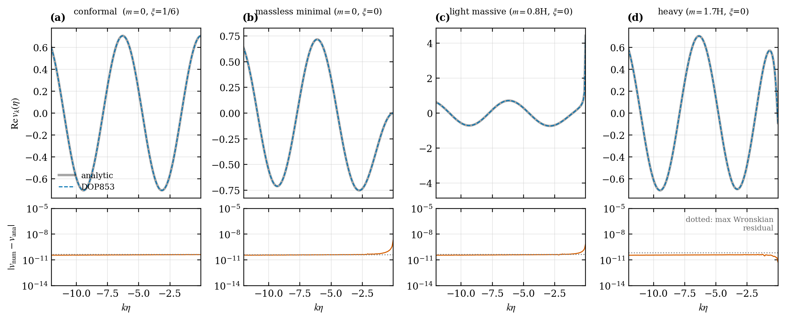

<sub>Real part of the rescaled mode function v_k(eta) for four parameter regimes (conformal, massless minimal, light massive, heavy): DOP853 integration versus the analytic Hankel solution, with residuals and the Wronskian floor below.</sub>

</div>

---

## Table of contents

1. [Overview](#1-overview)
2. [Quick start](#2-quick-start)
3. [Repository map](#3-repository-map)
4. [Theory: from the action to correlators](#4-theory-from-the-action-to-correlators)
   - [4.1 Conventions and geometry](#41-conventions-and-geometry)
   - [4.2 Action, Klein-Gordon equation, conformal time](#42-action-klein-gordon-equation-conformal-time)
   - [4.3 The rescaled mode equation and the index nu](#43-the-rescaled-mode-equation-and-the-index-nu)
   - [4.4 Canonical quantization and the Wronskian](#44-canonical-quantization-and-the-wronskian)
   - [4.5 Vacuum states](#45-vacuum-states)
   - [4.6 Wightman function and propagators](#46-wightman-function-and-propagators)
   - [4.7 Ultraviolet structure and renormalization](#47-ultraviolet-structure-and-renormalization)
   - [4.8 Infrared structure](#48-infrared-structure)
   - [4.9 Interactions and the in-in formalism](#49-interactions-and-the-in-in-formalism)
   - [4.10 Tree-level contact correlator and secular growth](#410-tree-level-contact-correlator-and-secular-growth)
   - [4.11 Tensor perturbations and the boundary with quantum gravity](#411-tensor-perturbations-and-the-boundary-with-quantum-gravity)
5. [Software architecture](#5-software-architecture)
6. [Validation strategy](#6-validation-strategy)
7. [Results and figures](#7-results-and-figures)
8. [Numerical methods in detail](#8-numerical-methods-in-detail)
9. [API guide](#9-api-guide)
10. [Reproducibility and provenance](#10-reproducibility-and-provenance)
11. [Notebooks and documentation index](#11-notebooks-and-documentation-index)
12. [Scope, limitations and honesty statement](#12-scope-limitations-and-honesty-statement)
13. [Roadmap: unimplemented research directions](#13-roadmap-unimplemented-research-directions)
14. [Extending the code, and optional third-party libraries](#14-extending-the-code-and-optional-third-party-libraries)
15. [Glossary](#15-glossary)
16. [References, citation and license](#16-references-citation-and-license)

---

## 1. Overview

This repository investigates **quantum fields on a prescribed, classical, four-dimensional de Sitter spacetime**. It follows a deliberate ladder of increasing physical content, and every rung is derived, implemented, and independently checked before the next one is built:

```
classical action  ->  Klein-Gordon equation  ->  mode equation  ->  canonical quantization
      ->  vacuum state  ->  Wightman / Green functions  ->  UV and IR structure
      ->  lambda phi^4 interaction  ->  in-in perturbation theory  ->  tree-level correlator
      ->  secular growth and perturbative validity  ->  tensor modes (boundary with quantum gravity)
```

### What this project is

- A **symbolically derived** pipeline: curvature, field equation, conformal-time equation and mode equation are produced by SymPy and compared with the closed forms, not typed in from memory.
- A **numerically validated** pipeline: every numerical result has an independent analytic or non-perturbative cross-check with a stated tolerance.
- A **reproducible** pipeline: every figure comes from an importable function, every run writes a JSON record containing parameters, tolerances, diagnostics, a data hash and software versions.

### What this project is not

- It is **not** a theory of quantum gravity. The metric is a fixed classical background; quantizing a test scalar does not quantize the geometry. See [Section 4.11](#411-tensor-perturbations-and-the-boundary-with-quantum-gravity).
- It is **not** a complete renormalized treatment. One point-splitting subtraction is implemented with its scheme dependence made explicit; no covariant Hadamard renormalization, no loop renormalization of the coupling.
- It does **not** present any numerical plot as a proof. Each result carries one of six classifications (below).

### Result classification used everywhere (docs, docstrings, JSON records)

| Tag | Meaning | Example in this repository |
|---|---|---|
| **A** | Analytic derivation | Hankel-function Bunch-Davies mode, contact correlator for nu = 1/2 |
| **S** | Symbolic verification | R = 12 H^2 in three charts; tensor equation from linearized Einstein equations |
| **N** | Numerical experiment | DOP853 mode evolution, Abel-regularized mode sum |
| **P** | Perturbative approximation | First-order tree-level contact correlator |
| **C** | Conceptual discussion | Hadamard condition, renormalization ambiguities, quantum-gravity boundary |
| **U** | Unimplemented research direction | Loops, second-order in-in, covariant renormalized stress tensor |

---

## 2. Quick start

```bash
git clone <your-fork-url> quantum-fields-on-de-sitter
cd quantum-fields-on-de-sitter

pip install -e ".[dev]"             # numpy, scipy, sympy, mpmath, matplotlib (+ pytest, nbformat, nbclient, ipykernel)

pytest                              # 82 tests, a few minutes
desitter-qft validate               # 17 programmatic checks -> results/validation.json
desitter-qft all --outdir figures   # regenerate all 12 figures + results/*.json (about 3 minutes)

python scripts/build_notebooks.py   # regenerate and execute the 12 notebooks
python scripts/build_report.py      # rebuild reports/technical_report.md from results/*.json
```

Individual experiments, each producing figures and a JSON record:

| Script | Produces | Content |
|---|---|---|
| `scripts/reproduce_free_modes.py` | Figs. 1-4, `results/free_modes.json` | modes, solver convergence, adiabatic vacuum, power spectra |
| `scripts/reproduce_two_point.py` | Figs. 5-8, `results/two_point.json` | Wightman function, UV structure, IR variance, propagators |
| `scripts/reproduce_tree_correlator.py` | Figs. 9-12, `results/tree_level.json` | contact correlator, secular growth, QM check, tensor spectrum |

A thirty-second sanity check of the whole stack:

```python
from desitter_qft.validation import run_all
for r in run_all():
    print("PASS" if r["passed"] else "FAIL", r["name"], f"{r['value']:.2e}")
```

---

## 3. Repository map

```
quantum-fields-on-de-sitter/
|-- README.md                      this file
|-- pyproject.toml                 package metadata, console script `desitter-qft`
|-- references.bib                 bibliography (see honesty statement)
|-- CITATION.cff, LICENSE          citation metadata (placeholders to fill), MIT license
|-- docs/                          18 derivation documents (one per physics topic)
|-- src/desitter_qft/              the importable package (about 1,900 lines)
|-- notebooks/                     12 executed notebooks (thin: they call the package)
|-- tests/                         82 pytest tests, including negative controls
|-- scripts/                       reproduction scripts, notebook and report builders
|-- figures/                       12 figures as PNG and PDF
|-- results/                       JSON records: parameters, tolerances, hashes, versions
`-- reports/technical_report.md    20-section report, numbers generated from results/
```

---

## 4. Theory: from the action to correlators

This section is a self-contained summary. Full derivations, with every integration by parts and boundary assumption, are in `docs/`.

### 4.1 Conventions and geometry

| Item | Choice |
|---|---|
| Signature, units | $(-+++)$, $c=\hbar=1$ |
| Riemann | $R^\rho{}_{\sigma\mu\nu}=\partial_\mu\Gamma^\rho_{\nu\sigma}-\partial_\nu\Gamma^\rho_{\mu\sigma}+\Gamma^\rho_{\mu\lambda}\Gamma^\lambda_{\nu\sigma}-\Gamma^\rho_{\nu\lambda}\Gamma^\lambda_{\mu\sigma}$, $R_{\sigma\nu}=R^\rho{}_{\sigma\rho\nu}$ |
| Curvature of dS | $R=+12H^2$, $R_{\mu\nu}=3H^2 g_{\mu\nu}$, $\Lambda=3H^2$ |
| Flat chart | $ds^2=-dt^2+e^{2Ht}d\mathbf x^2$ |
| Conformal time | $\eta=-1/(aH)\in(-\infty,0)$, $a(\eta)=-1/(H\eta)$, $a'/a=-1/\eta$, $a''/a=2/\eta^2$ |
| Fourier | $f(\mathbf x)=\int\frac{d^3k}{(2\pi)^3}\tilde f(\mathbf k)e^{i\mathbf k\cdot\mathbf x}$ |
| Mode normalization | $v_k v_k^{*\prime}-v_k^* v_k'=i$ |

**Three charts that must not be conflated.** The global chart covers the whole hyperboloid; the spatially flat expanding chart used for all numerics covers half of it and is past-incomplete (so $\eta\to-\infty$ is a coordinate horizon, not a Cauchy surface); the static patch covers one observer's causal diamond. A "state at $\eta\to-\infty$" is therefore a statement about mode behavior near the chart boundary.

The de Sitter invariant in the flat chart is

$$Z=\frac{\eta^2+\eta'^2-r^2}{2\eta\eta'},\qquad r=|\mathbf x-\mathbf x'|,$$

with $Z=\cos(H\sigma)$ for spacelike geodesic separation $\sigma$. The correctness of this expression is itself tested: the mode-sum and closed-form Wightman functions agree to $10^{-13}$ only if it is right.

### 4.2 Action, Klein-Gordon equation, conformal time

$$S[\phi]=-\frac12\int d^4x\sqrt{-g}\Big[g^{\mu\nu}\nabla_\mu\phi\nabla_\nu\phi+(m^2+\xi R)\phi^2\Big]\ \Longrightarrow\ (\Box-m^2-\xi R)\phi=0 .$$

The variation produces the boundary term $\oint d\Sigma_\mu\,\delta\phi\,\nabla^\mu\phi$, which vanishes for $\delta\phi=0$ on the boundary hypersurfaces. In the flat chart:

$$\ddot\phi+3H\dot\phi-\frac{\nabla^2}{a^2}\phi+(m^2+12\xi H^2)\phi=0,\qquad \phi''+2\frac{a'}{a}\phi'-\nabla^2\phi+a^2(m^2+\xi R)\phi=0 .$$

The friction term $3H\dot\phi=\partial_t\ln\sqrt{-g}\;\dot\phi$ is the dilution of field momentum density by the growth of comoving volume. The conformal-time equation is derived from the covariant d'Alembertian and independently cross-checked by the chain rule $\partial_t=a^{-1}\partial_\eta$ (both are asserted in the tests).

*Implemented in:* `scalar_action.py` (`euler_lagrange_vs_klein_gordon`, `conformal_time_equation`, `cosmic_time_equation_difference`, `cosmic_to_conformal_chain_rule`).

### 4.3 The rescaled mode equation and the index nu

Setting $v=a\phi$ and Fourier transforming,

$$v_k''+\Big[k^2+a^2m^2+(6\xi-1)\frac{a''}{a}\Big]v_k=0 \ \xrightarrow{\text{dS}}\ v_k''+\Big[k^2-\frac{\nu^2-\frac14}{\eta^2}\Big]v_k=0,\qquad \nu^2=\frac94-\frac{m^2}{H^2}-12\xi .$$

Rescaling removes the friction term, leaving a flat-space scalar with a time-dependent effective mass, so canonical momentum is simply $\pi_\chi=\chi'$.

**The regimes of nu are physically distinct and must not be treated alike:**

| $\nu^2$ | $\nu$ | Late-time $\phi_k$ | Infrared integrability of $k^2\lvert\phi_k\rvert^2$ | Series |
|---|---|---|---|---|
| $>9/4$ | real, $>3/2$ | grows as $(-\eta)^{3/2-\nu}$ | not integrable ($\lvert\phi_k\rvert^2\sim k^{-2\nu}$) | tachyonic |
| $=9/4$ | $3/2$ | frozen, $\to H/\sqrt{2k^3}$ | logarithmically divergent | massless minimal |
| $(0,9/4)$ | real | decays as $(-\eta)^{3/2-\nu}$ | integrable | complementary |
| $=0$ | $0$ | $(-\eta)^{3/2}\ln(-\eta)$ | integrable | boundary |
| $<0$ | $i\mu$ | $(-\eta)^{3/2}\cos(\mu\ln(-\eta)+\alpha)$ | integrable | principal |

**Analytic Bunch-Davies solution.** Positive frequency at early times, via $H^{(1)}_\nu(x)\sim\sqrt{2/\pi x}\,e^{i(x-\nu\pi/2-\pi/4)}$ (DLMF 10.17.5):

$$\boxed{v_k(\eta)=\frac{\sqrt\pi}{2}\,e^{i\pi(\nu/2+1/4)}\sqrt{-\eta}\;H^{(1)}_\nu(-k\eta)}\qquad v_k\to\frac{e^{-ik\eta}}{\sqrt{2k}} .$$

**Three core benchmarks:**

| Case | $\nu$ | Mode | Comment |
|---|---|---|---|
| $m=0,\ \xi=1/6$ | $1/2$ | $e^{-ik\eta}/\sqrt{2k}$ | all time dependence cancels: Weyl equivalence with flat space |
| $m=0,\ \xi=0$ | $3/2$ | $\frac{e^{-ik\eta}}{\sqrt{2k}}\big(1-\frac{i}{k\eta}\big)$ | frozen scale-invariant spectrum $\Delta^2_\phi=H^2/4\pi^2$ |
| massive | generic | Hankel form above | real or imaginary $\nu$ (imaginary uses `mpmath` complex-order Hankel) |

*Implemented in:* `mode_equations.py` (`derive_rescaled_mode_equation`, `nu_squared`, `regime`, `ModeEquation`), `analytic_modes.py`.

### 4.4 Canonical quantization and the Wronskian

For $\chi=a\phi$ the momentum is $\pi_\chi=\chi'$; equivalently $\pi_\chi=\pi_\phi/a+(a'/a)\chi$, so $[\hat\chi,\hat\pi_\chi]=[\hat\phi,\hat\pi_\phi]=i\delta^{(3)}$. With

$$\hat\chi=\int\frac{d^3k}{(2\pi)^3}\Big[\hat a_{\mathbf k}v_ke^{i\mathbf k\cdot\mathbf x}+\text{h.c.}\Big],\qquad [\hat a_{\mathbf k},\hat a^\dagger_{\mathbf k'}]=(2\pi)^3\delta^{(3)}(\mathbf k-\mathbf k'),$$

the equal-time commutator holds if and only if $v_kv_k^{*\prime}-v_k^*v_k'=i$. For a real second-order ODE this Wronskian is $\eta$-independent, so numerically it is a pure measure of integration error.

**Basis versus state.** A Bogoliubov-related basis $u_k=\alpha v_k+\beta v_k^*$ with $|\alpha|^2-|\beta|^2=1$ preserves the algebra but defines a *different Fock vacuum*. A mode basis is data used to construct a Fock space; the state is the one annihilated by the attached $\hat a_k$. The repository never rescales a solution after integration: `normalization.check_normalization` only reports residuals.

### 4.5 Vacuum states

| Object | What it is | Not to be confused with |
|---|---|---|
| Classical solution | function obeying the KG equation | an operator |
| Normalized mode basis | solutions with $W=i$ | a state |
| Fock-space construction | $\hat a,\hat a^\dagger,\lvert 0\rangle$ built from a basis | a unique physical vacuum |
| Quantum state | positive normalized functional on the field algebra | a coordinate system |
| Wightman function | $\omega(\hat\phi(x)\hat\phi(x'))$, a bi-distribution | a function with a finite coincident limit |
| Time-ordered propagator | $\omega(T\hat\phi\hat\phi)$ | the Green function of $\Box$ alone |
| Observable | smeared Hermitian operator | a formal mode sum |

**Bunch-Davies (BD).** The Fock vacuum of the mode that is positive-frequency at the chart's early boundary. It coincides with the Euclidean vacuum, is $SO(1,4)$-invariant where the two-point function exists (Chernikov-Tagirov, Bunch-Davies, Allen), and is one member of the one-parameter $\alpha$-vacuum family. For $\nu\ge 3/2$ the BD two-point function is infrared divergent and, at $\nu=3/2$, no de Sitter-invariant Fock vacuum exists at all (Allen-Folacci).

**Hankel-free confirmation.** `initial_conditions.adiabatic_data` builds WKB adiabatic vacua of order 0, 2, 4 from $W^2=\omega^2-[W''/2W-3W'^2/4W^2]$ iterated symbolically. Evolving them numerically converges to the analytic BD mode as $|\eta_0|\to\infty$, faster at higher order (Fig. 3c). This shows independently that the positive-frequency condition selects the BD state.

### 4.6 Wightman function and propagators

$$G^+(\eta,\eta',\mathbf r)=\langle\Omega|\hat\phi(x)\hat\phi(x')|\Omega\rangle=\frac{1}{2\pi^2}\int_0^\infty dk\,k^2\,\phi_k(\eta)\phi_k^*(\eta')\frac{\sin kr}{kr},\qquad \phi_k=v_k/a .$$

This is a bi-**distribution**: at equal times the integrand falls only as $k^{-1}$. The prescription used (Abel summation, not a cutoff) subtracts and restores the conformal-vacuum piece $|v_k|^2\to 1/2k$, whose transform is exactly $1/(4\pi^2r^2)$:

$$G^+(\eta,r)=H^2\eta^2\Big[\frac{1}{4\pi^2r^2}+\frac{1}{2\pi^2r}\int_0^\infty dk\,k\Big(|v_k|^2-\frac1{2k}\Big)\sin kr\Big],$$

with the remainder integrable like $k^{-2}$ and evaluated by QUADPACK QAWF.

**Closed form (Chernikov-Tagirov, Bunch-Davies):**

$$G^+=\frac{H^2}{16\pi^2}\,\Gamma\!\big(\tfrac32+\nu\big)\Gamma\!\big(\tfrac32-\nu\big)\;{}_2F_1\!\Big(\tfrac32+\nu,\tfrac32-\nu;2;\tfrac{1+Z}{2}\Big),$$

verified three ways: as a solution of the de Sitter-invariant ODE $(1-Z^2)G''-4ZG'-(\tfrac94-\nu^2)G=0$ (relative residual $\sim10^{-30}$), by reduction at $\nu=1/2$ to $H^2\eta\eta'/[4\pi^2(r^2-\Delta\eta^2)]$, and against the mode sum ($\sim10^{-13}$).

**Mode-space Green functions** for $D=\partial_\eta^2+\omega_k^2$:

| Function | Definition | Equation | State dependence |
|---|---|---|---|
| Wightman | $v(\eta)v^*(\eta')$ | $DG^+=0$ | BD |
| Feynman | $\theta(\eta-\eta')v v'^*+\theta(\eta'-\eta)v^*v'$ | $DG^F=-i\delta$ | BD ($i\epsilon$ at early times) |
| Retarded | $i\theta(\eta-\eta')[v(\eta)v^*(\eta')-\text{c.c.}]=-2\theta\,\mathrm{Im}[vv'^*]$ | $DG^R=\delta$ | **none** (fixed by the CCR) |
| Advanced | $G^A(\eta,\eta')=G^R(\eta',\eta)$ | $DG^A=\delta$ | none |

The delta strengths follow from the Wronskian: the derivative jump of $G^R$ is $i(v'v^*-v^{*\prime}v)=1$ and of $G^F$ is $-i$. $G^R$ is checked against an independent numerical solution of the ODE with $y(\eta')=0,\ y'(\eta')=1$ (no Hankel functions; difference $4\times10^{-12}$).

### 4.7 Ultraviolet structure and renormalization

With $u=(1-Z)/2=\sin^2(H\sigma/2)$, the connection formula of ${}_2F_1$ with $c=a+b-1$ (DLMF 15.8.10) gives

$$G^+=\frac{A}{u}+B\ln u+C+O(u\ln u),\quad A=\frac{H^2}{16\pi^2},\quad B=\Big(\tfrac94-\nu^2-2\Big)A,\quad C=B\Big[\psi(\tfrac32+\nu)+\psi(\tfrac32-\nu)+2\gamma_E-1\Big].$$

$B$ is independently recovered by a Frobenius recursion of the invariant ODE; all three coefficients are confirmed numerically (residual $\propto u\ln u$, Fig. 6b). Because $u\simeq H^2\sigma^2/4$, the leading singularity is $1/(4\pi^2\sigma^2)$: the flat-space form, independent of mass, coupling and state (Fig. 6a).

**Hadamard condition (conceptual, [C]).** A state is Hadamard if $G^+=\frac{1}{8\pi^2}\big[\Delta^{1/2}/\sigma^2+V\ln\sigma^2+W\big]$ with $V$ fixed locally by geometry and $m,\xi$, and only the smooth $W$ carrying state information (equivalently a wavefront-set condition, Radzikowski). Hadamard states are those for which Wick polynomials and $\langle T_{\mu\nu}\rangle$ can be defined consistently. BD is Hadamard; generic $\alpha$-vacua are not (antipodal singularities). The full Hadamard recursion is not implemented.

**A numerical cutoff is not a renormalization.** For $\nu=3/2$ with a comoving cutoff,
$\langle\phi^2\rangle_\Lambda=\frac{H^2}{4\pi^2}\big[\ln\frac{\Lambda}{k_{IR}}+\frac{\eta^2\Lambda^2}{2}\big]$ (exact; Fig. 6c): a quadratic divergence in physical units plus a log, a cutoff that breaks de Sitter invariance, no counterterm and no scheme.

**The one explicit subtraction implemented** (`two_point.coincident_phi2_pointsplit`):

$$\langle\phi^2\rangle_\mu\equiv\lim_{\sigma\to0}\Big[G^+-\frac{1}{4\pi^2\sigma^2}-B\ln(\mu^2\sigma^2)\Big]=\frac A3+C+B\ln\frac{H^2}{4\mu^2}.$$

Finite ambiguities, all stated and tested: the scale $\mu$; the choice of subtracting $1/4\pi^2\sigma^2$ rather than the full parametrix (the factor $\Delta^{1/2}=(H\sigma/\sin H\sigma)^{3/2}\simeq1+H^2\sigma^2/4$ shifts the constant by $H^2/16\pi^2$); and renormalization conditions for $m^2$ and $\xi$. For the conformal case $B=C=0$ and the result $H^2/48\pi^2$ is $\mu$-independent. **This is not presented as a unique renormalized value.**

### 4.8 Infrared structure

For real $\nu>0$, $H^{(1)}_\nu(x)\simeq-\frac{i}{\pi}\Gamma(\nu)(2/x)^\nu$ as $x\to0$, hence $|\phi_k|^2\propto k^{-2\nu}$ and $\int dk\,k^{2-2\nu}$ converges at $k\to0$ iff $\nu<3/2$.

- $\nu=3/2$: frozen spectrum, and the variance of modes between an IR scale $k_{IR}$ and the horizon grows linearly, $\langle\phi^2\rangle=\frac{H^2}{4\pi^2}N$ (that is $H^3t/4\pi^2$).
- $\nu<3/2$ with $m\ll H$: since $\tfrac32-\nu\simeq m^2/3H^2$, growth saturates after $N\sim3H^2/2m^2$ e-folds near $3H^4/8\pi^2m^2$.

**Independent benchmark.** The point-split $\langle\phi^2\rangle$ tends to $3H^4/8\pi^2m^2$ as $m\to0$ (through $\psi(\tfrac32-\nu)\to-1/(\tfrac32-\nu)$), matching the stationary solution $P_{\rm eq}\propto\exp[-8\pi^2V/3H^4]$ of the Starobinsky Fokker-Planck equation. For $V=\lambda\phi^4/4!$ the same equilibrium gives $\langle\phi^2\rangle\approx0.3228\,H^2/\sqrt\lambda$ (numerical, $\lambda=1$), which is non-perturbative in $\lambda$ and cannot be reproduced by a fixed-order series.

**Distinguish an IR-divergent intermediate expression from an ill-defined prediction.** Shift-invariant observables (derivative correlators, field differences) are IR finite even at $\nu=3/2$; the $k_{IR}$ dependence of $\langle\phi^2\rangle$ reflects the state or patch size. By contrast, the absence of an $SO(1,4)$-invariant state at $\nu=3/2$ is a theorem-level statement, not a cutoff artifact.

### 4.9 Interactions and the in-in formalism

$$S_{\rm int}=-\int d^4x\sqrt{-g}\,\frac{\lambda}{4!}\phi^4,\qquad [\lambda]=0\ \text{(verified in code)} .$$

The interaction has no derivatives, so $\pi_\phi=a^2\phi'$ is unchanged and the Legendre transform gives $\mathcal H_{\rm int}=-\mathcal L_{\rm int}=a^4\frac{\lambda}{4!}\phi^4=\frac{\lambda}{4!}\chi^4$, **explicitly time-independent for any $m$ and $\xi$**: all time dependence lives in the mode functions (verified symbolically).

**Why in-in rather than in-out.** The expanding patch has no late-time asymptotic region with a free-particle interpretation ($\eta\to0^-$ is a spacelike boundary). Cosmological observables are equal-time expectation values in a *given initial state*, not transition amplitudes:

$$\langle Q(\eta)\rangle=\Big\langle\Omega\Big|\bar T e^{i\int_{-\infty}^\eta H_I}\;Q_I(\eta)\;Te^{-i\int_{-\infty}^\eta H_I}\Big|\Omega\Big\rangle\ \xrightarrow{O(\lambda)}\ i\int_{-\infty}^\eta d\eta'\langle[H_I(\eta'),Q(\eta)]\rangle=-2\,\mathrm{Im}\!\int\!d\eta'\langle H_I(\eta')Q(\eta)\rangle .$$

Schwinger-Keldysh contour: time-ordered branch (vertices $-iH_I$) and anti-time-ordered branch (vertices $+iH_I$) joined at the final time; the $i\epsilon$ (Abel) prescription at $\eta\to-\infty$ projects the free vacuum onto the interacting one. The two branches are returned separately by `in_in.schwinger_keldysh_branches` and sum to the commutator form (tested).

**Assumptions stated explicitly:** free BD initial state; adiabatic switch-on; derivative-free vertex so $H_I=-L_I$; first order in $\lambda$. Different initial states or start times give different perturbative series.

**Independent validation of the formula.** The $0+1$-dimensional analogue $H=p^2/2+\omega^2q^2/2+gq^4/4!$ obeys the identical formula, $\kappa_4^{(1)}=-g/(32\omega^5)$, where $\kappa_4=\langle q^4\rangle-3\langle q^2\rangle^2$. Exact diagonalization of the ground state in a truncated oscillator basis reproduces the slope to a relative error of $1.6\times10^{-6}$ (Fig. 11), fixing sign and normalization without any field-theory machinery.

### 4.10 Tree-level contact correlator and secular growth

Specification (all items required by the project brief): vertex $-i\frac{\lambda}{4!}\chi^4$ (contact); external modes $v_{k_i}$; time range $(-\infty,\eta]$; free BD vacuum; Fourier measure $(2\pi)^3\delta^{(3)}$ stripped; order $\lambda^1$; contour rotation $\eta'=\eta-(1+i)s$ as the convergence prescription.

$$\langle\phi_{\mathbf k_1}\!\cdots\phi_{\mathbf k_4}\rangle'_{\rm conn}=-2\lambda H^4\eta^4\ \mathrm{Im}\Big[\prod_{i=1}^4 v^*_{k_i}(\eta)\int_{-\infty}^{\eta}d\eta'\prod_{i=1}^4v_{k_i}(\eta')\Big].$$

**Derivation sketch.** The $4!$ ways of contracting the four vertex fields with the four external fields cancel the $1/4!$; each contraction is $v_k(\eta')v_k^*(\eta)$; momentum conservation comes from $\int d^3x$; converting the external legs from $\chi$ to $\phi$ gives $a^{-4}=H^4\eta^4$. Vertex self-contractions are tadpole or disconnected pieces and are not part of the connected correlator.

**Analytic limit (validation).** For $\nu=1/2$ with $K=\sum k_i$,

$$\boxed{\langle\phi^4\rangle'_{\rm conn}=-\frac{\lambda H^4\eta^4}{8K\prod_i k_i}}$$

reproduced numerically to $3\times10^{-16}$ (Fig. 9a). The $\eta^4$ scaling is $a^{-4}$: conformal invariance means the interaction does not evolve in conformal variables.

**Massless minimal field (nu = 3/2): the secular logarithm.** Expanding $\phi_k(\eta')=\frac{H}{\sqrt{2k^3}}\big(1+\tfrac{k^2\eta'^2}{2}-\tfrac{ik^3\eta'^3}{3}+\dots\big)$, the $\eta'^3$ term in $a^4\prod\phi$ yields $\int d\eta'/\eta'$, so

$$\langle\phi^4\rangle'_{\rm conn}\ \xrightarrow{\eta\to0^-}\ \frac{\lambda H^4\sum_ik_i^3}{24\prod_ik_i^3}\,\ln(-\eta)+\text{const}.$$

For the tested momenta $(1,1.3,0.7,1.1)$ the coefficient is $0.2023507$, matched numerically with relative error below $10^{-6}$ (Fig. 9c).

**Perturbative validity (numerical experiment, Fig. 10).** The ratio $R=\langle\phi^4\rangle^{(1)}_{\rm conn}/P_k^2$ (equal momenta) behaves as follows:

| nu | Behavior in $N=\ln(1/k|\eta|)$ | Interpretation |
|---|---|---|
| $1/2$ | constant ($-\lambda/8$) | conformal invariance, no growth |
| $1$, $5/4$ | saturates | massive suppression, scale set by $1/(\tfrac32-\nu)$ |
| $3/2$ | grows linearly | secular term: fixed-order expansion degrades when $\lambda N\sim1$ |

**This signals the breakdown of the fixed-order expansion, not an inconsistency of the theory.** Resummation (Starobinsky stochastic dynamics; Starobinsky-Yokoyama; Marolf-Morrison; Hollands) controls the IR sector. Those methods are described, and the equilibrium variance is used as a benchmark, but they are not derived here.

### 4.11 Tensor perturbations and the boundary with quantum gravity

With $ds^2=a^2[-d\eta^2+(\delta_{ij}+h_{ij})dx^idx^j]$ and vacuum equations $R_{\mu\nu}=\Lambda g_{\mu\nu}$, the plus polarization $h_{xx}=-h_{yy}=\epsilon h(\eta,z)$ is plugged into the SymPy Ricci tensor. The background residual vanishes and

$$\delta(R_{xx}-\Lambda g_{xx})=\tfrac12\epsilon\big[h''+2\tfrac{a'}{a}h'-\partial_z^2h\big]\ \Longrightarrow\ h_k''-\tfrac{2}{\eta}h_k'+k^2h_k=0 .$$

With the standard quadratic action $S_2=\frac{M_p^2}{8}\int d\eta\,d^3x\,a^2[(h'_{ij})^2-(\partial_kh_{ij})^2]$ (quoted from the literature), $h_{ij}=\sum_\lambda e^\lambda_{ij}h_\lambda$ and $e^\lambda_{ij}e^{\lambda'}_{ij}=2\delta^{\lambda\lambda'}$, the variable $v_\lambda=M_pa\,h_\lambda/\sqrt2$ is a massless minimally coupled scalar ($\nu=3/2$) and

$$\Delta_t^2=\frac{k^3}{2\pi^2}\langle h_{ij}h_{ij}\rangle'=\frac{2H^2}{\pi^2M_p^2}.$$

Numerical integration reproduces the full $x=-k\eta$ dependence and the late-time plateau (Fig. 12).

**What changes when the metric itself is quantized (conceptual, [C]):**

- A test scalar has $\delta g_{\mu\nu}=0$. Quantizing $h_{\mu\nu}$ makes the geometry an operator and the scalar's $T_{\mu\nu}$ sources it, giving $O(G)$ corrections from matter-gravity and graviton self-interaction vertices.
- Gauge fixing (for example de Donder, with Faddeev-Popov ghosts) or reduction to gauge-invariant variables is required; the Hamiltonian and momentum constraints remove unphysical components. De Sitter has no spatial infinity and no globally defined energy, so there is no standard S-matrix.
- General relativity is perturbatively non-renormalizable ('t Hooft-Veltman; Goroff-Sagnotti) but is a valid effective field theory below $M_p$ (Donoghue), with corrections of order $H^2/M_p^2$ and contested de Sitter infrared issues.

**Explicitly not claimed:** that quantizing a scalar quantizes gravity; any graviton loop; any solution of the non-perturbative de Sitter quantum-gravity problem.

---

## 5. Software architecture

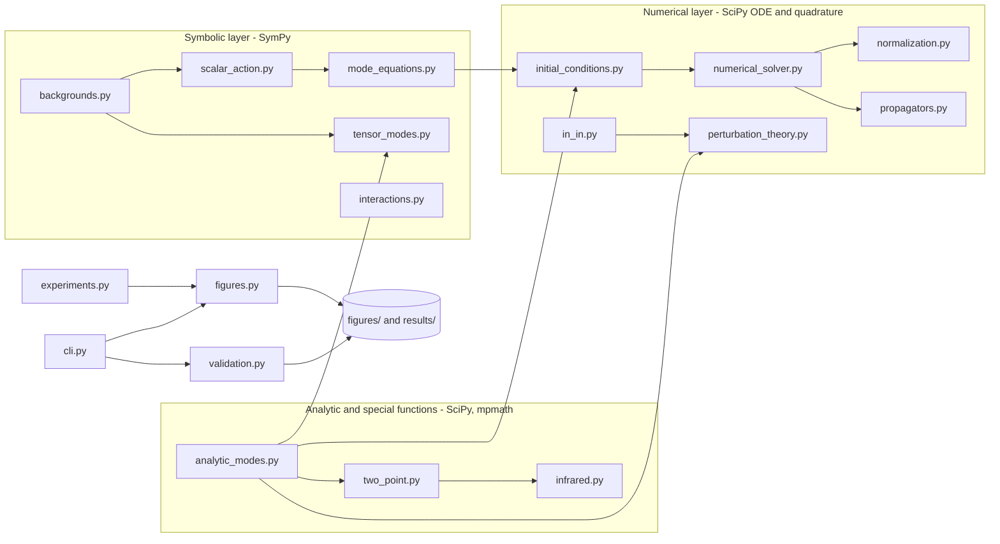

The diagram is schematic: arrows show the main dependency and data flow between modules.

**Design rules enforced by the layout:** symbolic derivations are separate from numerics; essential calculations live in the package, never only in notebooks; experiments return plain arrays (no plotting) so tests, scripts and notebooks share one implementation; plotting and provenance are isolated modules.

| Module | Responsibility | Principal public objects |
|---|---|---|
| `backgrounds.py` | de Sitter chart handling; symbolic Christoffel, Riemann, Ricci | `DeSitter`, `ricci_scalar`, `ricci_tensor`, `flat_chart_metric_cosmic`, `static_patch_metric` |
| `scalar_action.py` | symbolic Euler-Lagrange, covariant box, cosmic and conformal equations | `euler_lagrange_vs_klein_gordon`, `conformal_time_equation`, `cosmic_to_conformal_chain_rule` |
| `mode_equations.py` | rescaled mode equation, nu, regime classification | `ModeEquation`, `nu_squared`, `nu`, `regime`, `omega_squared` |
| `analytic_modes.py` | Hankel BD modes and derivatives, closed-form benchmarks | `bunch_davies_mode`, `bunch_davies_mode_derivative`, `conformal_mode`, `minimal_massless_mode` |
| `normalization.py` | Wronskian checker, never rescales | `wronskian`, `check_normalization`, `NormalizationReport` |
| `initial_conditions.py` | exact BD data and WKB adiabatic data (orders 0, 2, 4) | `exact_bd_data`, `adiabatic_data` |
| `numerical_solver.py` | adaptive mode integration with metadata | `solve_mode`, `ModeSolution` |
| `two_point.py` | mode-sum and closed-form Wightman function; UV coefficients; cutoffs; point splitting | `wightman_mode_sum`, `wightman_closed_form`, `short_distance_coefficients`, `coincident_phi2_pointsplit`, `phi2_cutoff` |
| `propagators.py` | mode-space Wightman, Feynman, retarded, advanced | `wightman_k`, `feynman_k`, `retarded_k`, `retarded_from_ode` |
| `interactions.py` | symbolic $H_{\rm int}$, dimensional bookkeeping | `interaction_hamiltonian_density`, `check_dimensions` |
| `in_in.py` | first-order contact integrals, contour rotation, SK branches | `contact_correlator`, `conformal_contact_correlator`, `massless_minimal_log_coefficient`, `schwinger_keldysh_branches` |
| `perturbation_theory.py` | QM exact-diagonalization benchmark, secular ratio | `qm_first_order_slope`, `anharmonic_ground_state_cumulant`, `secular_ratio` |
| `infrared.py` | coarse-grained variance, stochastic equilibrium moments | `ir_variance`, `stochastic_equilibrium_moments` |
| `tensor_modes.py` | symbolic tensor equation, tensor spectrum | `derive_tensor_equation`, `dimensionless_tensor_spectrum` |
| `experiments.py` | reproducible experiment functions returning arrays | one function per figure group |
| `figures.py`, `plotting.py` | publication style, Okabe-Ito palette, figure builders | `make_free_mode_figures`, `make_two_point_figures`, `make_tree_figures` |
| `provenance.py` | environment capture, rounded-array hashing, JSON records | `environment_info`, `hash_arrays`, `write_record` |
| `validation.py`, `cli.py` | 17 programmatic checks; console entry point | `run_all`, `main` |

---

## 6. Validation strategy

The guiding rule: **no result is trusted because one code path produced it.** Each quantity is verified by a second, structurally different route, and tests are designed to fail when the physics is wrong (negative controls).

### 6.1 Independent-check matrix

| Quantity | Route 1 | Independent route 2 (and 3) | Agreement |
|---|---|---|---|
| Curvature $R=12H^2$ | cosmic chart | conformal chart; static patch | exact (symbolic) |
| Conformal-time KG equation | covariant box | chain rule from cosmic time | exact (symbolic) |
| Hankel mode | Wronskian $=i$ | direct ODE substitution via mpmath derivatives; DOP853 integration; WKB adiabatic vacuum | $3\times10^{-13}$; $2\times10^{-13}$; $2\times10^{-9}$; error falls with adiabatic order and $\lvert\eta_0\rvert$ |
| $\nu=3/2$ closed-form mode | closed form | Hankel mode | $1\times10^{-13}$ |
| Wightman function | Abel mode sum | hypergeometric closed form; invariant ODE; $\nu=1/2$ flat limit | $2\times10^{-13}$ (real nu), $10^{-9}$ (imaginary nu) |
| Short-distance coefficients | DLMF 15.8.10 | Frobenius recursion for $B$; numerics at small $u$ | residual $\propto u\ln u$ |
| Retarded function | Hankel modes | numerical ODE with unit-slope initial data | $4\times10^{-12}$ |
| In-in first order | derived formula | exact diagonalization of quartic oscillator | $1.6\times10^{-6}$ |
| Contour rotation | rotated contour | real-axis Abel damping, extrapolated to zero | linear convergence in $\epsilon$ |
| Contact correlator | numerical contour | analytic $\nu=1/2$ result; derived $\nu=3/2$ log slope | $3\times10^{-16}$; below $10^{-6}$ |
| Double versus extended precision | scipy backend | mpmath backend | $10^{-8}$ at $\nu=1$ |
| Light-field variance | point-split $\langle\phi^2\rangle$ | Fokker-Planck Gaussian equilibrium | ratio $\to1+O(m^2/H^2)$ |
| Tensor equation | SymPy Einstein tensor | claimed form | exact (symbolic) |
| Tensor spectrum | numerical ODE | $2H^2/\pi^2M_p^2$ | $10^{-6}$ at $x=10^{-3}$ |

### 6.2 The 17 programmatic checks (`desitter-qft validate`)

Symbolic: $R=12H^2$ in three charts; Euler-Lagrange equals $\sqrt{-g}(\Box-m^2-\xi R)\phi$; cosmic-time equation with $3H\dot\phi$; conformal equation versus chain rule; rescaled mode equation; de Sitter reduction; tensor equation. Numeric and analytic: Hankel Wronskian; Hankel ODE substitution; closed form versus Hankel at $\nu=3/2$; DOP853 versus analytic; mode sum versus closed form; invariant-ODE residual; QM in-in slope; conformal contact correlator. Results are archived in `results/validation.json` with tolerances.

### 6.3 Negative controls (tests that must be able to fail)

- Wrong normalization: $2v$ has Wronskian $4i$ and the checker flags residual $3$.
- Wrong curvature sign convention: asserting $R=-12H^2$ fails.
- Wrong $\xi$: the closed-form conformal mode does not solve the minimally coupled equation (residual $>0.1$).
- Wrong sign of the in-in slope would fail the exact-diagonalization comparison.
- Bogoliubov coefficients violating $|\alpha|^2-|\beta|^2=1$ break the Wronskian (notebook 06).
- Hash sensitivity: perturbing data by $10^{-6}$ changes the recorded hash.

### 6.4 What the numerics do and do not establish

Numerical agreement *validates*, but does not *prove*, the analytic statements. A plot is never used as a proof; each figure is accompanied by the analytic or independent result it checks.

---

## 7. Results and figures

All figures are generated by `desitter-qft all` and saved as PNG and PDF. Each caption states the claim and its classification.

### 7.1 Geometry and horizon crossing (Fig. 1) [A, S]

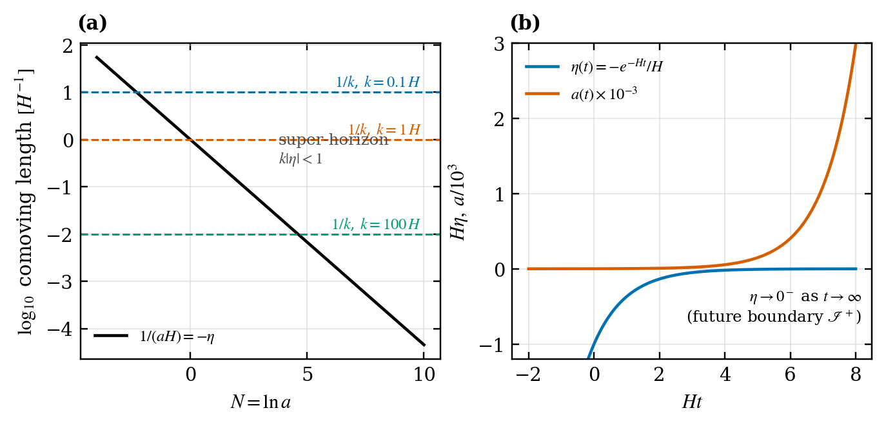

The comoving Hubble radius $1/(aH)=-\eta$ shrinks, so every comoving scale $1/k$ eventually exits the horizon ($k|\eta|=1$). The map $t\mapsto\eta(t)$ shows $\eta\to0^-$ as $t\to\infty$ (the future boundary).

### 7.2 Modes, solver convergence and the vacuum (Figs. 2-3) [A, N]

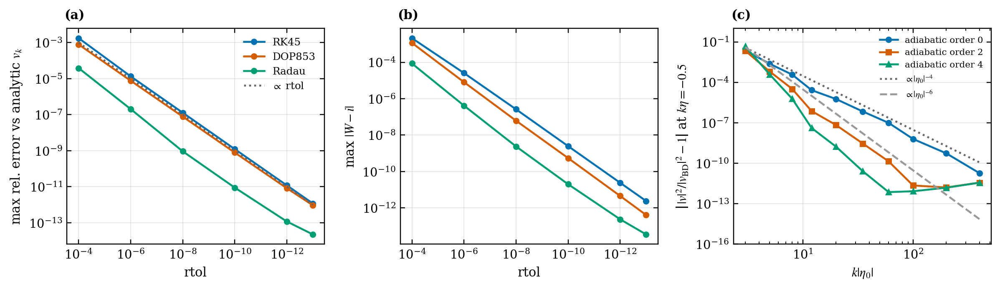

(a) Maximum relative error versus analytic mode scales linearly with `rtol` over nine decades for RK45, DOP853 and Radau before saturating near $10^{-12}$ (round-off). (b) The Wronskian residual follows the same scaling and is never rescaled. (c) Hankel-free adiabatic initial data of order 0, 2, 4 converge to the analytic BD mode as $|\eta_0|$ grows, faster at higher order: the positive-frequency boundary condition independently selects the BD state.

Recorded diagnostics (`results/free_modes.json`, rtol $10^{-11}$, DOP853, $k=1$, $\eta\in[-80,-0.02]$):

| Case | max abs error | initial $\lvert W-i\rvert$ | max $\lvert W-i\rvert$ |
|---|---|---|---|
| conformal | $4\times10^{-11}$ | $4\times10^{-16}$ | $5\times10^{-11}$ |
| massless minimal | $2\times10^{-9}$ | $2\times10^{-16}$ | $4\times10^{-11}$ |
| light massive ($m=0.8H$) | $7\times10^{-10}$ | $2\times10^{-16}$ | $4\times10^{-11}$ |

### 7.3 Power spectra and freeze-out (Fig. 4) [A, N]

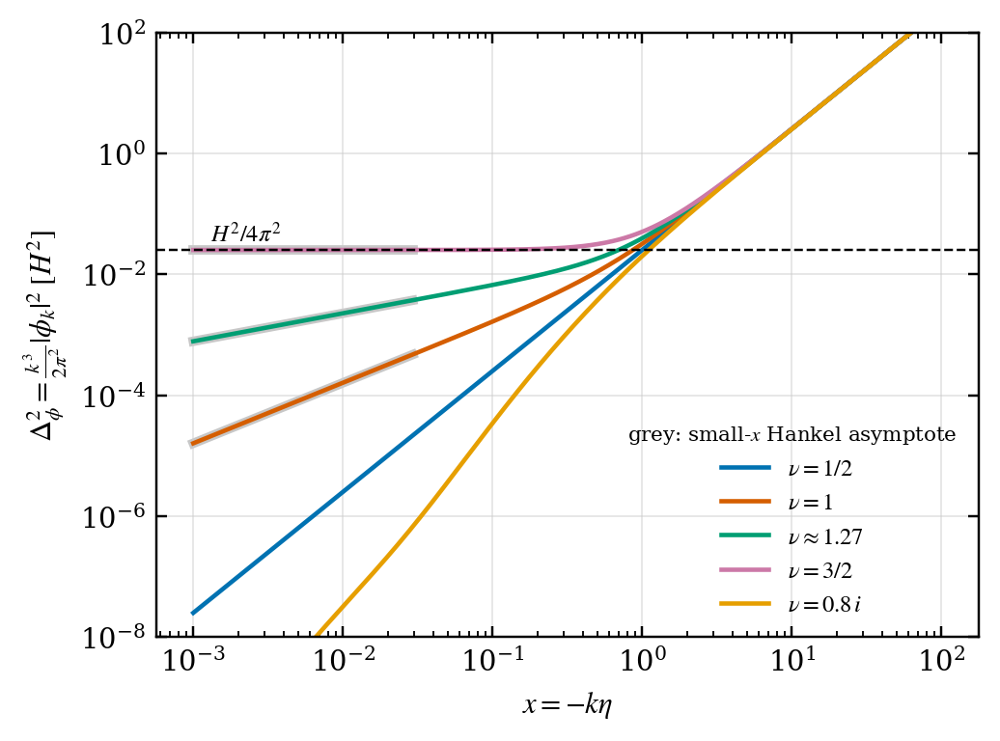

The dimensionless spectrum $\Delta_\phi^2=\frac{k^3}{2\pi^2}|\phi_k|^2$ freezes at $H^2/4\pi^2$ for $\nu=3/2$, decays as $x^{3-2\nu}$ for real $\nu<3/2$ (grey: analytic Hankel asymptote), and decays with log-periodic oscillation for imaginary $\nu$.

### 7.4 Wightman function: mode sum versus closed form (Fig. 5) [A, N]

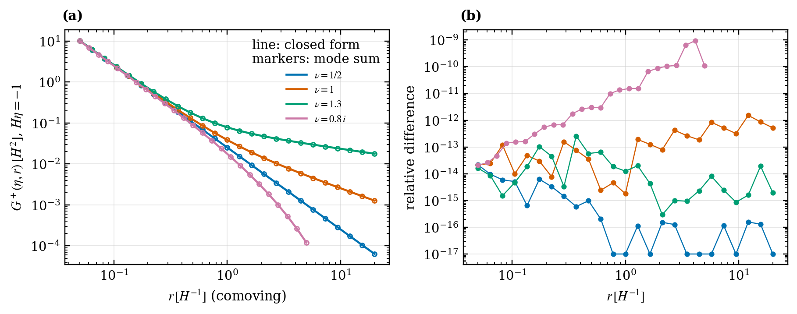

The Abel-regularized mode sum (markers) reproduces the hypergeometric closed form (lines) to $10^{-13}$ for real $\nu$ and $10^{-9}$ for imaginary $\nu$. This tests the Hankel normalization, the Fourier convention and the invariant $Z$ simultaneously.

### 7.5 Ultraviolet structure (Fig. 6) [A, N]

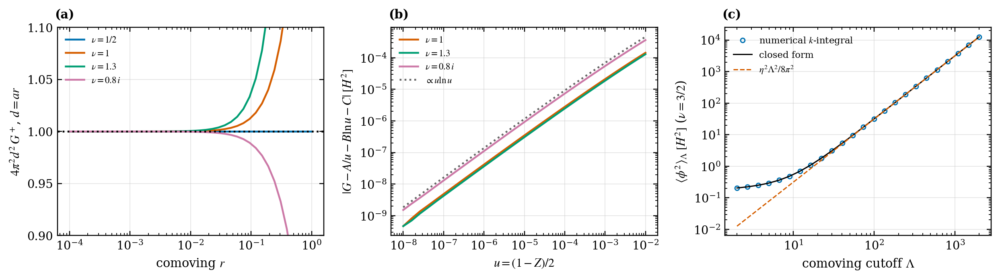

(a) The leading singularity is the flat-space $1/(4\pi^2d^2)$ for all $\nu$. (b) The expansion $A/u+B\ln u+C$ leaves a residual scaling as $u\ln u$ (the conformal case has $B=C=0$ and is omitted: its residual is round-off). (c) A sharp comoving cutoff gives the exact $\Lambda^2$ divergence plus a logarithm: a diagnostic of divergence structure, not a renormalization.

### 7.6 Infrared variance (Fig. 7) [N]

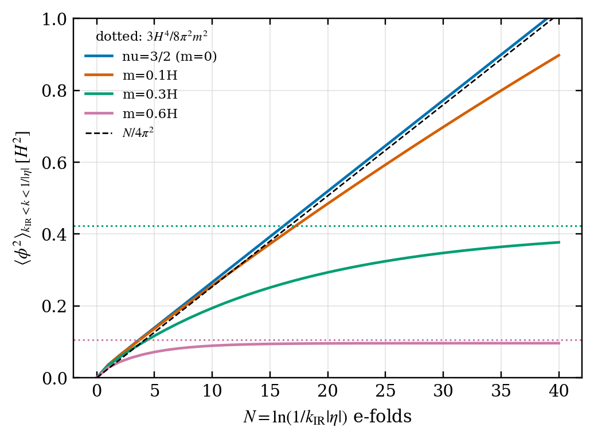

For $\nu=3/2$ the variance grows as $N/4\pi^2$; for light massive fields it saturates near $3H^4/8\pi^2m^2$ (dotted, leading order in $m/H$). The $m=0.6H$ plateau ($0.096\,H^2$) differs from the leading-order estimate ($0.105\,H^2$) by the expected subleading corrections.

### 7.7 Propagators (Fig. 8) [A, N]

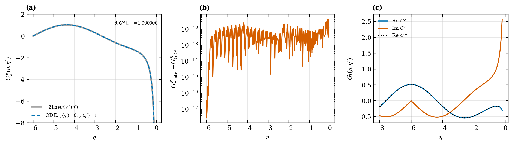

(a, b) The retarded function from Hankel modes agrees with an independent Hankel-free ODE solution to $4\times10^{-12}$ and has derivative jump $1.0000000001$. (c) The Feynman function is continuous at coincidence with a slope kink of $-i$ and $\mathrm{Re}\,G^F=\mathrm{Re}\,G^+$.

### 7.8 Tree-level contact correlator (Fig. 9) [P, N]

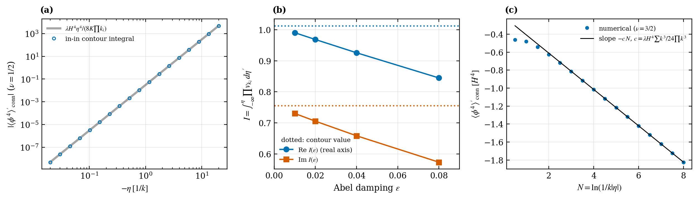

(a) Conformal case: numerical in-in integral versus the analytic $-\lambda H^4\eta^4/(8K\prod k_i)$. (b) Real-axis Abel-damped integrals converge linearly in $\epsilon$ to the rotated-contour value. (c) Massless minimal case: numerical correlator against the derived logarithmic slope.

### 7.9 Secular growth and perturbative validity (Fig. 10) [N]

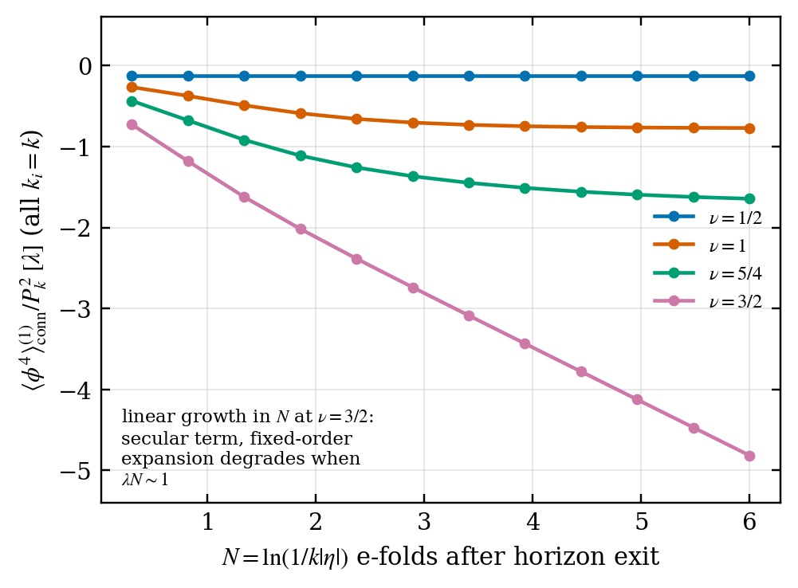

Conformal: constant. Massive: saturating. Massless minimal: linear in $N$, so the fixed-order result degrades for $\lambda N\sim1$. This is a statement about the expansion.

### 7.10 In-in versus exact diagonalization (Fig. 11) [P]

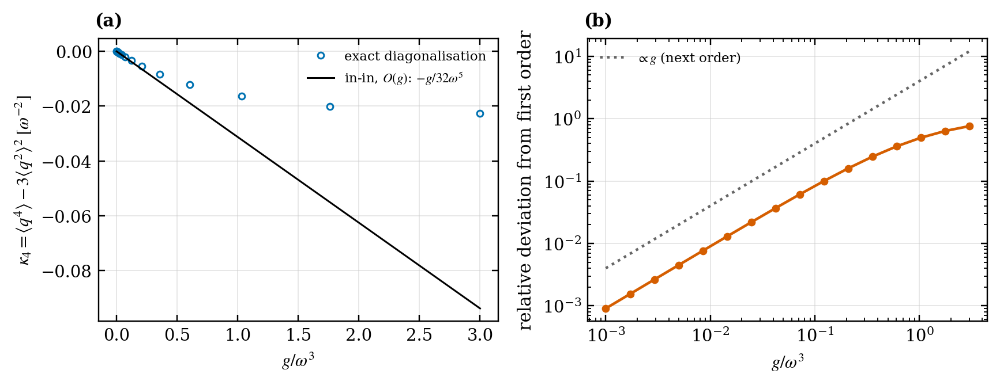

The exact fourth cumulant approaches the first-order in-in line as $g\to0$ with a relative deviation scaling as $g$ (next order), fixing the sign and normalization of the in-in formula.

### 7.11 Tensor spectrum (Fig. 12) [S, A, N]

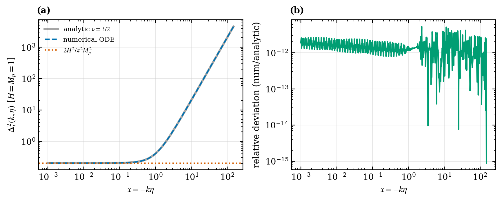

Numerical integration of the tensor mode equation reproduces the analytic $\nu=3/2$ spectrum and its plateau $2H^2/(\pi^2M_p^2)=0.2026424$ (numerical $0.2026426$ at $x=10^{-3}$).

---

## 8. Numerical methods in detail

| Component | Method | Notes |
|---|---|---|
| Mode ODE | `scipy.integrate.solve_ivp`, default DOP853 (also RK45, Radau) | state $(\mathrm{Re}\,v,\mathrm{Im}\,v,\mathrm{Re}\,v',\mathrm{Im}\,v')$; `rtol` $10^{-4}$-$10^{-13}$, `atol` about $10^{-2}$ `rtol` or $10^{-13}$ |
| Scaling | $v_k(\eta)=k^{-1/2}f(k\eta)$ | all numerics at $k=1$ |
| Hankel functions | `scipy.special.hankel1`, `jv`, `yv` for real order; `mpmath.hankel1` for imaginary order | derivative via DLMF 10.6.2 |
| Hypergeometric and Gamma | `mpmath.hyp2f1`, `gamma`, `digamma` | 30-40 digits |
| Distributional $k$-integral | QUADPACK QAWF (`weight='sin'`) on the tail, ordinary QAGS on the head | Abel-regularized by subtracting $1/2k$ |
| In-in time integral | contour rotation $\eta'=\eta-(1+i)s$, split at geometric breakpoints | double precision (`scipy.quad`) or 40-digit `mpmath.quad` |
| WKB initial data | symbolic iteration, lambdified | even orders 0, 2, 4 |
| Exact diagonalization | `scipy.linalg.eigh` in an oscillator basis (up to 140 states) | $g>0$ only (bounded potential) |

**Known precision hazards, handled explicitly.**

- Late-time in-in: the imaginary part is a difference of quantities of magnitude $\sim(k|\eta|)^{-7}$ for $\nu=3/2$; double precision would lose most digits, so `contact_correlator` defaults to the 40-digit `mpmath` backend for $\nu\in\{1/2,3/2\}$ and a test cross-checks both backends elsewhere.
- Wronskian growth: the residual scales with $|v||v'|$; for the tensor mode at $\eta=-10^{-3}$ it reaches about $2\times10^{-7}$ at `rtol` $10^{-12}$. This is reported, never hidden by rescaling.
- Imaginary-order Hankel evaluation through `mpmath` limits tail-integral accuracy to about $10^{-11}$ absolute, so imaginary-$\nu$ position-space tests stop at $r\le5$.

---

## 9. API guide

### 9.1 Solve and audit a mode

```python
from desitter_qft.mode_equations import ModeEquation, regime
from desitter_qft.initial_conditions import adiabatic_data
from desitter_qft.numerical_solver import solve_mode
from desitter_qft.normalization import check_normalization
from desitter_qft.analytic_modes import bunch_davies_mode

eq = ModeEquation(k=1.0, m=0.8, xi=0.0)           # nu = 1.2689 (real: complementary series)
print(eq.nu, regime(eq.nu2))

v0, dv0 = adiabatic_data(eq, eta0=-100.0, order=4)  # Hankel-free WKB initial data
sol = solve_mode(eq, -100.0, -0.05, v0, dv0, rtol=1e-11, atol=1e-13)

rep = check_normalization(sol.eta, sol.v, sol.dv, rtol=1e-11, atol=1e-13, method="DOP853")
print(rep.max_residual, rep.passes)                 # about 4.5e-11, True (no rescaling applied)

ref = abs(bunch_davies_mode(sol.eta[-1], 1.0, eq.nu))**2
print(abs(sol.v[-1])**2 / ref - 1)                  # about -1.2e-11: converged to Bunch-Davies
```

### 9.2 Two-point function and short-distance structure

```python
from desitter_qft.two_point import (wightman_mode_sum, wightman_closed_form_equal_time,
                                    short_distance_coefficients, coincident_phi2_pointsplit)

print(wightman_mode_sum(-1.0, 1.0, 1.3))            # 0.0785331553854931  (Abel mode sum)
print(wightman_closed_form_equal_time(-1.0, 1.0, 1.3))  # 0.07853315538549409 (closed form)

A, B, C = short_distance_coefficients(1.3)          # G = A/u + B ln u + C + O(u ln u)
phi2 = coincident_phi2_pointsplit(1.3, mu=1.0)      # scheme-dependent finite part (see Section 4.7)
```

### 9.3 First-order in-in correlator

```python
from desitter_qft.in_in import (contact_correlator, conformal_contact_correlator,
                                massless_minimal_log_coefficient)

ks = [1.0, 1.3, 0.7, 1.1]
print(contact_correlator(-0.5, ks, nu=0.5, lam=1.0))      # -0.0019035842206573913
print(conformal_contact_correlator(-0.5, ks, lam=1.0))    # -0.001903584220657392  (analytic)

c = massless_minimal_log_coefficient(ks, lam=1.0)         # 0.2023507: coefficient of ln(-eta) at nu = 3/2
```

`contact_correlator(..., backend="auto" | "mp" | "scipy")` selects extended or double precision; `auto` uses `mp` for $\nu\in\{1/2,3/2\}$.

### 9.4 Symbolic derivations

```python
from desitter_qft.backgrounds import flat_chart_metric_conformal, ricci_scalar
from desitter_qft.scalar_action import euler_lagrange_vs_klein_gordon
from desitter_qft.tensor_modes import derive_tensor_equation

g, X = flat_chart_metric_conformal();  print(ricci_scalar(g, X))     # 12*H**2
print(euler_lagrange_vs_klein_gordon()[2])                           # 0
print(derive_tensor_equation()["difference_from_claim"])             # 0
```

### 9.5 Infrared benchmark and tensor spectrum

```python
from desitter_qft.infrared import stochastic_equilibrium_moments, free_massive_stochastic_phi2
from desitter_qft.tensor_modes import tensor_spectrum_late_time

print(stochastic_equilibrium_moments(lambda p: p**4/24)[2])   # 0.3227558 (lambda = 1, H = 1)
print(tensor_spectrum_late_time())                            # 0.2026424 = 2/pi^2
```

### 9.6 Command line

```
desitter-qft free-modes  --outdir figures
desitter-qft two-point   --outdir figures
desitter-qft tree        --outdir figures
desitter-qft validate    --outdir figures
desitter-qft all         --outdir figures
```

---

## 10. Reproducibility and provenance

Every experiment writes a record to `results/` with:

- model parameters, initial conditions, integration interval, solver method and tolerances;
- numerical precision and error diagnostics (Wronskian reports, maximum residuals, function-evaluation counts);
- `data_sha256`: a SHA-256 of the output arrays rounded to 10 decimals, insensitive to last-bit noise;
- software versions captured at run time (Python, NumPy, SciPy, SymPy, mpmath, Matplotlib).

Determinism is tested: repeated runs of the quartic-oscillator and tensor experiments give identical hashes, and a $10^{-6}$ perturbation changes the hash. There is no randomness anywhere in the code. `reports/technical_report.md` section 17 is generated from the JSON records by `scripts/build_report.py`, so the report cannot drift from the code.

| File | Written by | Content |
|---|---|---|
| `results/free_modes.json` | `reproduce_free_modes.py` | mode runs, Wronskian reports, tolerance sweep |
| `results/two_point.json` | `reproduce_two_point.py` | mode-sum versus closed-form errors, propagator diagnostics |
| `results/tree_level.json` | `reproduce_tree_correlator.py` | contact correlator, QM check, tensor spectrum |
| `results/validation.json` | `desitter-qft validate` | all 17 checks with tolerances |

---

## 11. Notebooks and documentation index

### Notebooks (all executed; they call the package and display the stored figures)

| Notebook | Topic | Tag |
|---|---|---|
| `01_geometry_and_curvature` | curvature in three charts, horizon crossing | S |
| `02_klein_gordon_derivation` | action to KG, two derivations of the conformal equation | S |
| `03_free_mode_equations` | rescaled equation, nu regimes | S, A |
| `04_analytic_mode_solutions` | Hankel modes, Wronskian, ODE substitution | A |
| `05_numerical_mode_evolution` | solver, tolerance sweep, adiabatic vacuum | N |
| `06_canonical_quantization` | Wronskian, Bogoliubov invariance and violation | A |
| `07_vacuum_structure` | IR integrability versus nu, cutoff variance | A, N |
| `08_wightman_functions` | mode sum versus closed form, UV coefficients | A, N |
| `09_interacting_scalar_fields` | $H_{\rm int}$, dimensional analysis | S |
| `10_in_in_perturbation_theory` | QM exact-diagonalization validation, SK branches | P |
| `11_tree_level_correlators` | contact correlator, log, secular ratio | P, N |
| `12_tensor_perturbations` | tensor equation, spectrum | S, N |

### Derivation documents (`docs/`)

`conventions` | `de_sitter_geometry` | `scalar_action` | `klein_gordon_derivation` | `conformal_time` | `mode_equation` | `canonical_quantization` | `vacuum_states` | `wightman_functions` | `propagators` | `interacting_scalar_fields` | `in_in_formalism` | `perturbative_correlators` | `infrared_structure` | `ultraviolet_structure` | `renormalization` | `tensor_perturbations` | `limitations`

---

## 12. Scope, limitations and honesty statement

**Implemented and validated:** free scalar for real, marginal and imaginary nu; Wightman function and short-distance structure; mode-space Green functions; first-order tree-level contact correlator; tensor modes on a fixed background.

**Explicit limitations:**

1. Fixed four-dimensional de Sitter, spatially flat chart only. The BD state is a statement about the chart boundary, not an initial condition on a complete Cauchy surface.
2. For $\nu\ge3/2$ the BD two-point function is infrared divergent; results with a cutoff depend on it.
3. Point-splitting constants are scheme dependent and are not claimed to be unique or fully covariant.
4. Secular growth signals the breakdown of the fixed-order expansion, not an inconsistency of the theory.
5. Double-precision Hankel evaluation loses digits at late times for generic nu; `mpmath` is used where it matters.
6. The tensor-action normalization is quoted from the literature and validated by reproducing the standard spectrum; it is not rederived symbolically from the Einstein-Hilbert action.
7. Numerical agreement validates but does not prove analytic statements.

**Metadata caveats:**

- `references.bib` was written from bibliographic knowledge and has **not** been machine-verified against Crossref or INSPIRE. Verify volume, page and DOI fields before citing.
- `CITATION.cff` and `LICENSE` contain placeholders for author name and repository URL. Fill them before publishing.

---

## 13. Roadmap: unimplemented research directions

| Direction | What it needs | Priority |
|---|---|---|
| Second-order and exchange diagrams | nested time integrals, $\pm$ branch propagators | high |
| One-loop tadpole with covariant Hadamard renormalization | Hadamard recursion for $V$, $\Delta^{1/2}$, $\langle\phi^2\rangle$ and $\langle T_{\mu\nu}\rangle$ | high |
| Stochastic resummation versus fixed-order in-in | Fokker-Planck solver, comparison at overlapping orders | high |
| $\alpha$-vacua and Hadamard violation | Bogoliubov-transformed modes, antipodal singularity diagnostics | medium |
| Global chart and static-patch (thermal) analysis | other mode bases, Gibbons-Hawking temperature check | medium |
| Scalar and vector metric perturbations with constraints | gauge-invariant variables, constraint solution | medium |
| Graviton interactions and EFT loops | cubic action, gauge fixing, ghosts | long term |
| Boundary correlators and dS/CFT-like structure | late-time operator expansion | long term |

---

## 14. Extending the code, and optional third-party libraries

The repository currently depends only on NumPy, SciPy, SymPy, mpmath and Matplotlib (plus pytest and the notebook stack for development). Third-party libraries are welcome for the research directions above. **None of the following are currently used**; they are suggestions, each tied to a concrete bottleneck:

| Library | Possible role | Motivation |
|---|---|---|
| `numba` or `jax` | JIT or autodiff for mode integration and quadrature | speed for large $k$-grids and higher-order nested integrals |
| `diffrax` (with `jax`) | differentiable, high-order ODE solving | sensitivity of correlators to parameters |
| `cadabra2` or `sympy.diffgeom` | tensor algebra for metric perturbation expansions | deriving the cubic gravity action and constraints |
| `flint` / `python-flint` or `gmpy2` | faster arbitrary-precision arithmetic | accelerating the late-time `mpmath` evaluations |
| `emcee` or `scipy.stats` | uncertainty exploration across $(m,\xi,\lambda)$ | mapping the validity region of fixed-order expansions |
| `h5py` or `zarr` | storage of large correlator grids | scaling `data/` beyond JSON |
| `sphinx` with `myst-parser` | rendered documentation from `docs/` | publication-grade documentation site |

**Adding a new observable, in four steps:** derive the expression in a `docs/` file with its assumptions; implement it in the package with a docstring giving its classification tag; add an independent check (second analytic route or non-perturbative benchmark) and at least one negative control in `tests/`; register a programmatic check in `validation.py` and an experiment in `experiments.py` so that the figure, JSON record and report update together.

---

## 15. Glossary

| Term | Meaning here |
|---|---|
| Bunch-Davies state | Fock vacuum of the mode that is positive-frequency at the early boundary of the flat chart; the Euclidean vacuum |
| Conformal time | $\eta$ with $d\eta=dt/a$; $\eta<0$ in the expanding patch |
| Wronskian | $vv^{*\prime}-v^*v'$; equals $i$ for canonically normalized modes |
| Wightman function | $\langle\Omega\vert\hat\phi(x)\hat\phi(x')\vert\Omega\rangle$, a bi-distribution |
| Hadamard state | state whose two-point function has the universal local singular structure fixed by geometry |
| Abel summation | regularization of conditionally convergent oscillatory integrals by an exponential damping factor taken to zero |
| In-in formalism | closed-time-path computation of expectation values in a specified initial state |
| Contact diagram | tree diagram with a single vertex connecting all external legs |
| Secular term | contribution growing with time (here logarithmically in the scale factor) that spoils fixed-order perturbation theory |
| Super-horizon | modes with $k\vert\eta\vert<1$ |
| Cumulant $\kappa_4$ | connected fourth moment $\langle q^4\rangle-3\langle q^2\rangle^2$ |
| Principal / complementary series | imaginary / real $\nu$ regimes of de Sitter scalar representations |

---

## 16. References, citation and license

The full bibliography is in `references.bib` (see the verification caveat in [Section 12](#12-scope-limitations-and-honesty-statement)). Principal sources by topic:

- **Foundations:** Birrell and Davies (1982); Wald (1994).
- **de Sitter vacua and Wightman functions:** Chernikov and Tagirov (1968); Bunch and Davies (1978); Mottola (1985); Allen (1985); Allen and Folacci (1987); Gibbons and Hawking (1977).
- **In-in formalism:** Schwinger (1961); Keldysh (1964); Calzetta and Hu (1987); Weinberg (2005); Maldacena (2003).
- **Infrared and stochastic methods:** Starobinsky (1986); Starobinsky and Yokoyama (1994); Marolf and Morrison (2011); Hollands (2013).
- **UV structure and renormalization:** Wald (1977); Radzikowski (1996); Hollands and Wald (2001).
- **Tensors and quantum gravity:** Grishchuk (1974); Starobinsky (1979); Mukhanov, Feldman and Brandenberger (1992); 't Hooft and Veltman (1974); Goroff and Sagnotti (1986); Abbott and Deser (1982); Donoghue (1994).
- **Special functions and software:** NIST DLMF; Hairer, Norsett and Wanner; SciPy, NumPy, SymPy, mpmath, Matplotlib.

**Citing.** Use `CITATION.cff` after replacing the placeholder author and repository fields.

**License.** MIT (see `LICENSE`).

<div align="center">

<br>

[Back to top](#quantum-fields-on-de-sitter-spacetime)

</div>
